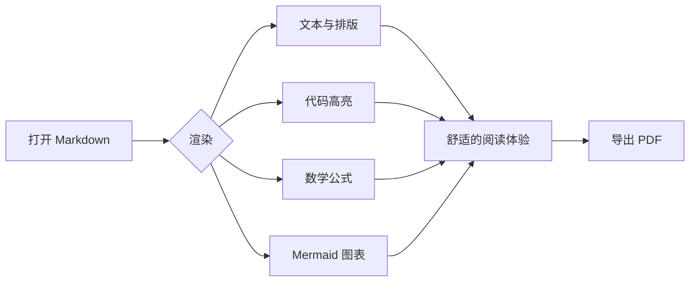
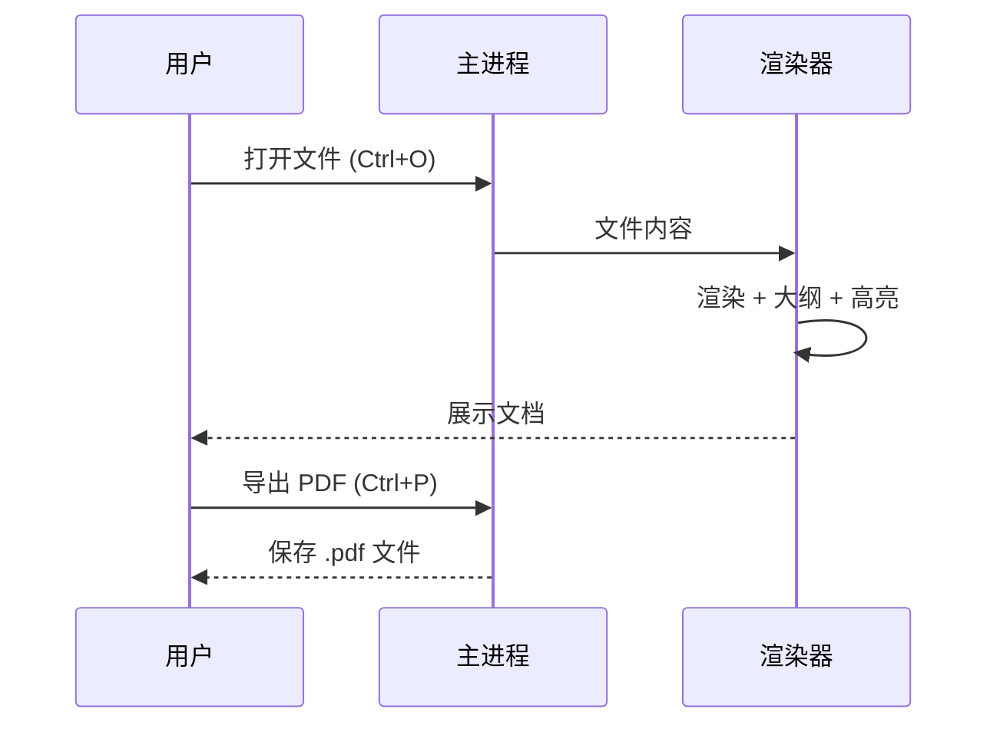

# MarkView 示例文档


欢迎使用 **MarkView** —— 一个简洁的本地 Markdown 阅读与编辑工具。本文档用于展示各项渲染能力，你可以用左侧大纲快速跳转，用 `Ctrl+F` 搜索，用右上角按钮切换主题，或按 `Ctrl+P` 导出 PDF。

> 好的阅读体验，来自克制的排版：舒适的行高、清晰的层级、安静的配色。

## 一、文本样式

支持 **加粗**、*斜体*、~~删除线~~、`行内代码`，以及 [外部链接](https://commonmark.org) 和自动链接 https://github.com 。

中英文混排时字数统计会分别计算汉字与英文单词。阅读时长基于每分钟约 400 字估算，显示在底部状态栏。

### 1.1 引用与分隔线

> 单层引用：简洁的灰色竖线。
>
> > 嵌套引用：适合摘录中的摘录。

---

### 1.2 列表

无序列表：

- 大纲导航，随滚动高亮当前章节
- 三套主题：浅色 / 深色 / 护眼
- 文件外部修改后自动刷新，保留阅读位置

有序列表：

1. 打开文件（`Ctrl+O` 或拖入窗口）
2. 阅读与跳转
3. 导出 PDF（`Ctrl+P`）

任务列表：

- [x] Markdown 渲染与排版
- [x] 代码高亮与一键复制
- [x] 数学公式与图表
- [ ] 更多主题（欢迎期待）

## 二、代码高亮

行内代码如 `npm start`，代码块带语言标签与复制按钮。

```javascript
// 快速排序
function quickSort(arr) {
  if (arr.length <= 1) return arr;
  const pivot = arr[0];
  const left = arr.slice(1).filter((x) => x < pivot);
  const right = arr.slice(1).filter((x) => x >= pivot);
  return [...quickSort(left), pivot, ...quickSort(right)];
}

console.log(quickSort([3, 6, 1, 8, 2, 9, 4]));
```

```python
from dataclasses import dataclass

@dataclass
class Reader:
    name: str
    words_per_minute: int = 400

    def reading_time(self, words: int) -> float:
        return words / self.words_per_minute

print(Reader("Qoder").reading_time(1200))  # 3.0 分钟
```

```bash
# 启动应用
npm install
npm start
```

```json
{
  "name": "markview",
  "theme": "light",
  "features": ["outline", "search", "katex", "mermaid", "pdf"]
}
```

## 三、表格

| 功能 | 快捷键 | 说明 |
| --- | --- | --- |
| 打开文件 | `Ctrl+O` | 支持拖拽打开 |
| 文内搜索 | `Ctrl+F` | `Enter` 下一个，`Shift+Enter` 上一个 |
| 大纲侧栏 | `Ctrl+Shift+L` | 点击标题跳转 |
| 导出 PDF | `Ctrl+P` | A4 分页，自动页码 |
| 缩放 | `Ctrl+=` / `Ctrl+-` | `Ctrl+0` 重置，支持 Ctrl+滚轮 |

## 四、数学公式

行内公式：质能方程 $E = mc^2$，欧拉恒等式 $e^{i\pi} + 1 = 0$。

块级公式：

$$
\int_{-\infty}^{\infty} e^{-x^2} \, dx = \sqrt{\pi}
$$

$$
f(x) = \sum_{n=0}^{\infty} \frac{f^{(n)}(a)}{n!}(x-a)^n
$$

## 五、图表（Mermaid）

流程图：



时序图：



## 六、脚注与长文

Markdown 由 John Gruber 于 2004 年创建[^1]，如今已成为技术写作的事实标准[^2]。

[^1]: 参见 CommonMark 规范。
[^2]: 常见于 README、文档站点与笔记工具。

### 6.1 关于阅读

阅读长文档时，大纲侧栏会跟随滚动高亮当前章节；顶部细线显示阅读进度。切换主题不会丢失阅读位置，文件在外部编辑器中保存后会自动刷新。

### 6.2 关于导出

PDF 导出强制使用浅色排版，代码块自动换行，标题不会孤悬页尾，表格与图表尽量保持完整，页脚自动添加页码。

## 七、图片

相对路径图片会自动解析到文档所在目录，点击可放大查看：


---

*感谢阅读，祝使用愉快。*