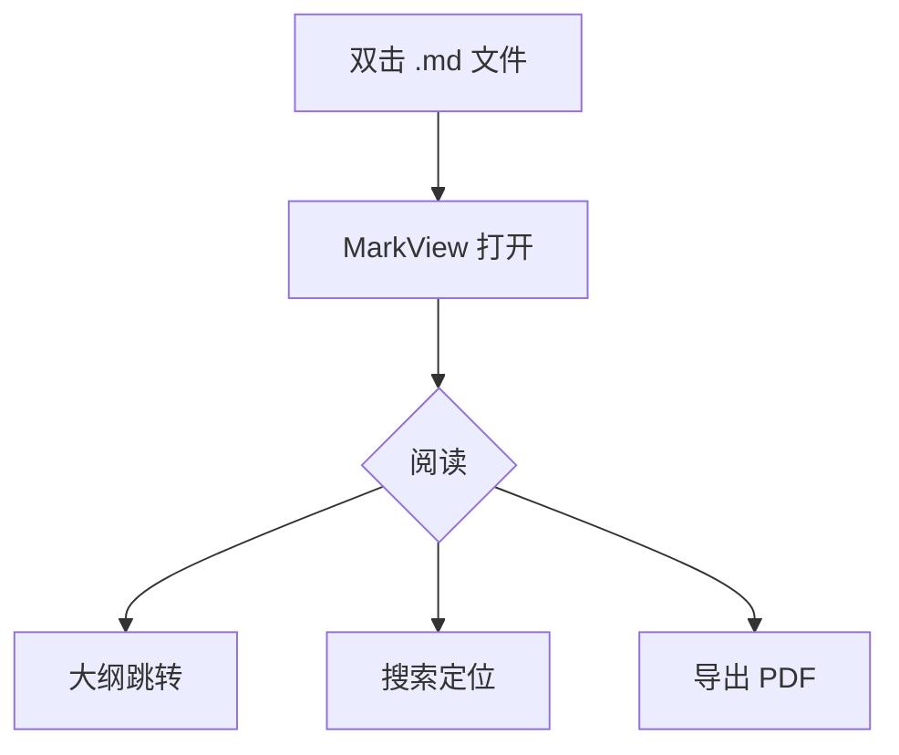
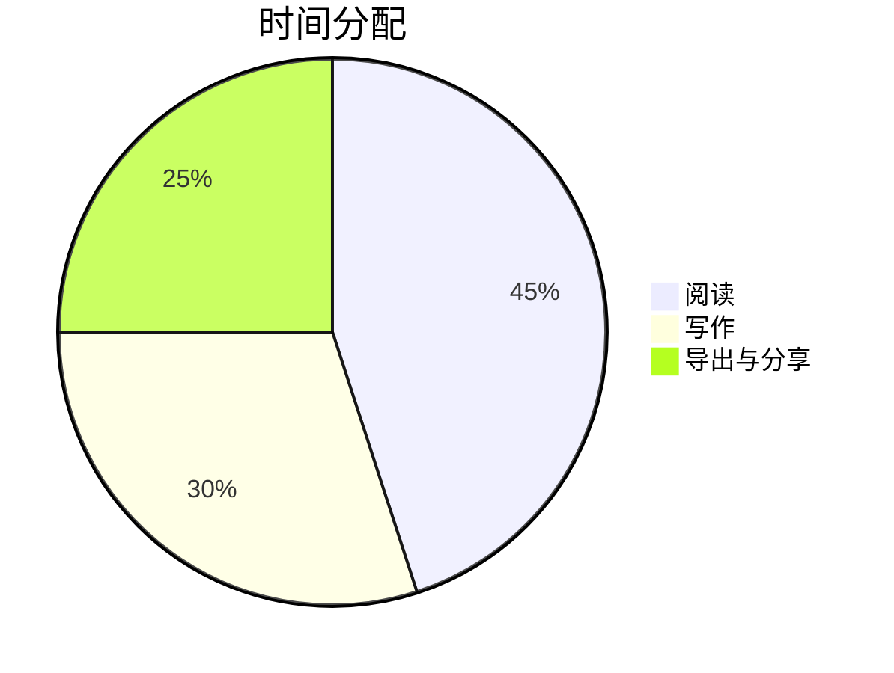

# 格式演示

这是一份放在项目根目录的**全格式演示文档**：双击它（或右键"用 MarkView 打开"）即可查看渲染效果。下面涵盖常用文本与格式。

## 一、文本样式

**加粗**、*斜体*、***加粗斜体***、~~删除线~~、`行内代码`、[外部链接](https://commonmark.org)、自动链接 https://github.com ，以及上标式脚注引用[^note]。

中英文混排：The quick brown fox jumps over the lazy dog. 敏捷的棕色狐狸跳过懒狗。键盘按键写作 `Ctrl` + `O`、`Esc`。

> 单层引用：安静的灰色竖线。
>
> > 嵌套引用：摘录中的摘录。

---

## 二、标题层级

### 三级标题

#### 四级标题

##### 五级标题

###### 六级标题

## 三、列表

无序嵌套：

- 阅读体验
  - 大纲导航
  - 三套主题
- 导出能力
  - PDF 分页

有序嵌套：

1. 第一步
   1. 子步骤 A
   2. 子步骤 B
2. 第二步

任务列表：

- [x] 已完成事项
- [x] 再来一项
- [ ] 待办事项

## 四、表格（含对齐）

| 左对齐 | 居中 | 右对齐 |
| :--- | :---: | ---: |
| 文本 | 文本 | 123 |
| 较长的单元格内容 | 居中内容 | 45678 |
| `代码` | **加粗** | *斜体* |

## 五、代码块

```javascript
const greet = (name) => `你好, ${name}!`;
console.log(greet('MarkView')); // 你好, MarkView!
```

```python
def fib(n: int) -> int:
    a, b = 0, 1
    for _ in range(n):
        a, b = b, a + b
    return a
```

```diff
- 旧的一行
+ 新的一行
  上下文行
```

## 六、数学公式

行内：$a^2 + b^2 = c^2$ 与 $\frac{1}{2}$。

块级：

$$
\begin{aligned}
\nabla \cdot \mathbf{E} &= \frac{\rho}{\varepsilon_0} \\
\nabla \times \mathbf{B} &= \mu_0 \mathbf{J} + \mu_0 \varepsilon_0 \frac{\partial \mathbf{E}}{\partial t}
\end{aligned}
$$

## 七、图表





## 八、图片

相对路径图片（指向 assets 目录），点击可放大：


## 九、脚注

[^note]: 这是一个脚注，点击正文中的引用编号可以跳到这里，末尾的回跳箭头可以返回。

---

*演示结束。试试 `Ctrl+F` 搜索"引用"，或切换右上角主题看看不同配色。*